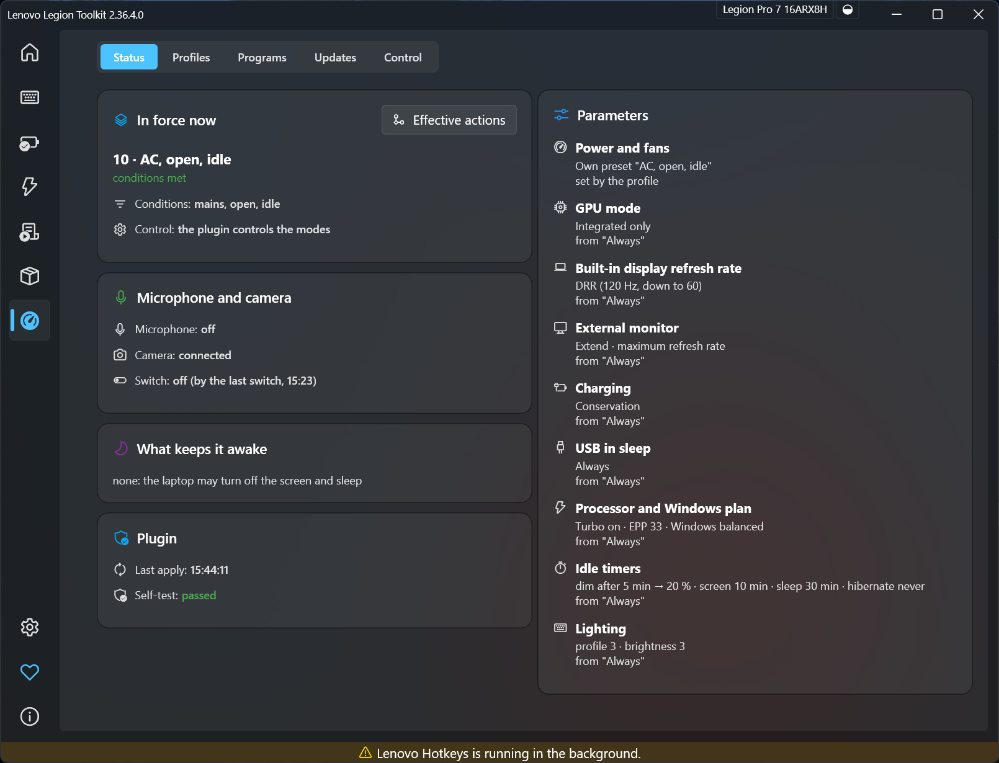
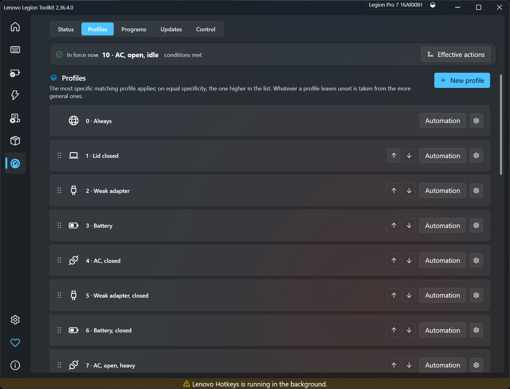
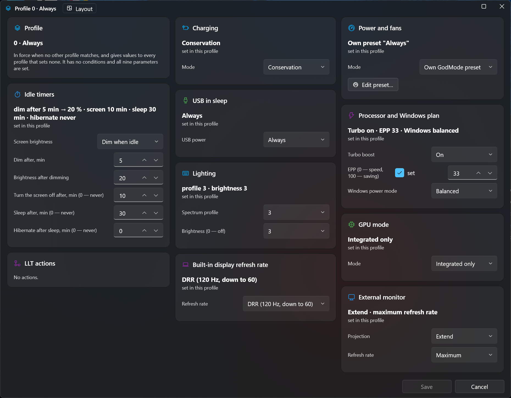
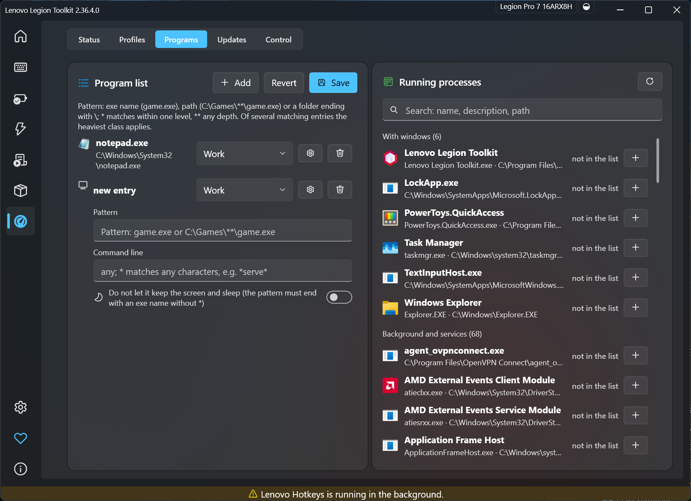
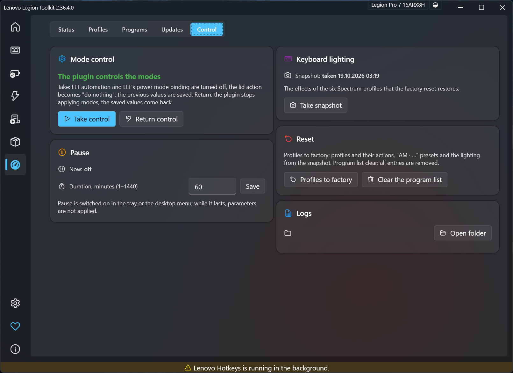

# LLT – Advanced modes

**English** · [Русский](README.ru.md)

A plugin for [Lenovo Legion Toolkit](https://github.com/LenovoLegionToolkit-Team/LenovoLegionToolkit) (the Team fork, 2.36.4.0) that
makes the laptop pick its own mode. You describe *profiles* – a combination of power source, lid, workload and external monitor, each
with its own power limits, fan curve, GPU mode, panel refresh rate, charging, idle timers, keyboard lighting and automation – and the
laptop moves between them by itself. A small supervisor keeps that working when LLT crashes, a scheduled task fails or an update goes wrong.

> Built and tested on one machine: Lenovo Legion Pro 7 16ARX8H (82WS), Windows 11 LTSC. It writes firmware settings through LLT.
> Read [Safety](#safety) before you install it on anything else.



## What it adds to stock LLT

Stock LLT gives you the power modes (Quiet, Balance, Performance, GodMode with its presets), hybrid mode, refresh rate, battery
and lighting controls, and an automation list: pipelines with triggers and steps. Each pipeline is independent; you decide which of them
win when several fire. This plugin builds a layer on top:

| | Stock LLT | Advanced modes |
|---|---|---|
| What decides the settings | Whatever the pipelines that fired last have set | **One profile is in force at any time**, chosen from the four conditions: power source (AC / weak adapter / battery), lid (open / closed), workload (idle / work / AI / heavy), external monitor (connected / none). The most specific matching profile wins |
| A complete set of values | Spread over pipelines and presets | A profile holds **every parameter**: power & fans (a GodMode preset or a firmware mode), GPU mode, panel refresh rate (including dynamic 120/60 and a true 60 Hz signal), external-display projection and refresh, charging mode, USB power in sleep, processor boost / EPP / Windows power mode, four idle timers, keyboard lighting profile and brightness |
| Inheritance | none | A profile inherits what it does not set from the profiles above it (root «Always» at the top); the page shows where each value comes from |
| Automation | One global list | LLT's own step editor **inside each profile**, with «enter» and «leave» events; inherited pipelines can be switched off or reordered |
| Workload | You trigger it yourself | Classes from a programs list (heavy > AI > work > idle), with delay and hold times per profile so a profile does not flap |
| GodMode presets | One at a time, by hand | The plugin keeps **a preset per profile** (`AM · <profile name>`), writes the factory curves and limits, and verifies the fan table and GPU values after every apply |
| Lid and bag safety | Windows lid action | The plugin sets the lid action to "do nothing" while it is in control; a **guard service** puts a closed laptop with no display to sleep after a minute when the plugin is silent, whatever has crashed |
| Idle | Windows timers | Four stages (dim, display off, sleep, hibernate) per profile; video players and wake requests are read from Windows power requests; a per-program switch to ignore a program's requests |
| Updates of LLT | Updater | LLT is **pinned** to the version the package carries. A **keeper** checks the new releases and reports whether the plugin is compatible with them (every reference, reflection contract and referenced assembly version); it installs nothing by itself. A new LLT is installed by you, after you have looked at the result, and the pin moves with it |
| Manual overrides | Quick actions | Autonomy (battery life) profile, stay awake, rapid charge, charge to full, force a workload, pause – each lifted by the right event (an adapter, the lid, a reboot) |
| Status | – | Under every parameter the page shows what the hardware itself reports (firmware, controller, display path, power scheme, battery, drivers) beside what the profile asks for, and warns when they differ; the discrete card's presence, temperature and load are live |
| Interface | – | A page inside LLT, tray items, a dashboard card and a desktop context menu, all in LLT's own look; English and Russian built in, **more languages as plain files** |

The factory set has 25 profiles tuned for this laptop (see `docs/` in the source for the values). Reset to factory is one button.

## Screenshots

| | |
|---|---|
|  |  |
|  |  |

## Requirements

- Windows 11, administrator rights for the installation.
- [Lenovo Legion Toolkit Team fork **2.36.4.0**](https://github.com/LenovoLegionToolkit-Team/LenovoLegionToolkit/releases/tag/v2.36.4.0)
  (the package carries its installer, checked against a pinned SHA-256 and the publisher's signature).
- PowerShell 7 and the .NET 9 Desktop Runtime.
- A Lenovo Legion laptop. The factory values and the firmware ranges are for the Legion Pro 7 16ARX8H; other models need their own
  values, and the plugin has not been tested on them.

## Installation

### From a release

1. Install [PowerShell 7](https://aka.ms/powershell) and the [.NET 9 Desktop Runtime](https://dotnet.microsoft.com/download/dotnet/9.0).
2. Download `LLT-Advanced-Modes-<version>.zip` from the Releases page and unpack it.
3. Open **PowerShell 7 as administrator** in the unpacked folder and run:

   ```powershell
   pwsh -NoProfile -ExecutionPolicy Bypass -File .\Install-LegionModes.ps1
   ```

   The script installs LLT 2.36.4.0 only if it is absent, then the plugin, the keeper (a logon scheduled task), the guard service
   and the desktop menu. It is idempotent and logs to `D:\ProgramData\LegionModes\install.log` (or `%ProgramData%\LegionModes`).
4. Open LLT. A new item **Advanced modes** appears in the left menu.
5. The plugin installs **inactive**: LLT keeps control until you open *Advanced modes → Control* and press **Take control**.
   «Return control» gives everything back.

Uninstall: `Uninstall-LegionModes.ps1` from the same folder (your settings and backups are kept).

### From source

```powershell
git clone https://github.com/axazolai/LLT-Advanced-Modes
cd LLT-Advanced-Modes
pwsh -NoProfile -File .\apps\legion-modes\Build-LegionModes.ps1 -Stage
```

The script installs the pinned .NET SDK into `_work\dotnet` (no system change), downloads the pinned LLT installer and checks its
hash, builds, runs the tests and stages the package in `depot\software\legion-modes\`. Then run `Install-LegionModes.ps1` from there as above.

## Languages and translations

The interface follows LLT's own language setting (LLT *Settings → Language*) and changes **without a restart**.

- The texts of the plugin are English **keys**. A translation is a file named after the culture code (`ru.json`, `de.json`,
  `pt-BR.json`): a flat JSON object that maps the English key to your text:

  ```json
  {
    "Status": "Status",
    "Profiles": "Profiles",
    "Found {0}": "Found {0}"
  }
  ```

  Keep the `{0}`, `{1}` placeholders as they are. A key that ends in `|2`, `|3` tells two meanings of one English word apart
  (`Update` and `Update|2`); the suffix is never shown.
- The package ships `lang\en.json` (every key mapped to itself: edit a value to reword the English text) and `lang\ru.json`
  (the Russian texts). `en.json` is the template for a new language: copy it, rename it, translate the values.
- Without a file for the language the English keys show. So: Russian LLT → Russian, every other LLT language → English until
  you add its file.
- Put your file into `%LOCALAPPDATA%\LenovoLegionToolkit\Plugins\Configs\LegionModes\lang\` – this folder is never touched by
  installs and updates. The package's own folder (`...\Plugins\LegionModes\lang\`) is replaced on every update. Your folder is
  laid over the package's, so you can also override single Russian or English texts there.
- For LLT language `de-DE` the files `de.json`, then `de-DE.json` are laid over each other; a missing key shows English.
- **Profile names** are translatable too, without a screen for it: a name you type is saved under the interface language you are
  using; a profile without a name in the current language shows its English name (the built-in profiles have both Russian and English
  names). The GodMode presets in LLT's list are labelled `AM · <name in the current language>`.

Pull requests with new languages are welcome: add `apps/legion-modes/src/LegionModes.Plugin/lang/<code>.json` (the test suite
checks that every key used in the code is in `en.json` and `ru.json` with the same placeholders).

## Safety

- The plugin writes power limits, fan tables, GPU values, refresh rates and Windows power settings through LLT. Wrong values can
  make a machine hot, loud or unstable. The factory values are measured for one laptop.
- It never takes control on its own: the take-control button is yours. A crash of the plugin, of LLT or of the scheduled task is
  covered by the guard (a closed laptop with no display goes to sleep, never stays awake in a bag).
- LLT is pinned. The plugin reports a newer release and its compatibility result and installs nothing; you move to a new version yourself.
- The factory profiles use no undervolting. If a profile sets the all-core Curve Optimizer and the machine shuts down abnormally
  three times in a row, the plugin writes it back to 0 in every preset.

No warranty. You use it at your own risk.

## Project layout

```
apps/legion-modes/            the source (.NET 9): Core, Plugin, Keeper, Guard, Quick, Updates, tests
apps/legion-modes/src/LegionModes.Plugin/lang/   translation files
apps/legion-modes/install/    Install-/Uninstall-LegionModes.ps1, Stage-Depot.ps1
docs/                         this README's pictures and notes
```

## License

GPL-3.0 – see [LICENSE](LICENSE). Lenovo Legion Toolkit is a separate GPL-3.0 project by its authors; this plugin is not affiliated
with Lenovo or with the LLT authors.
